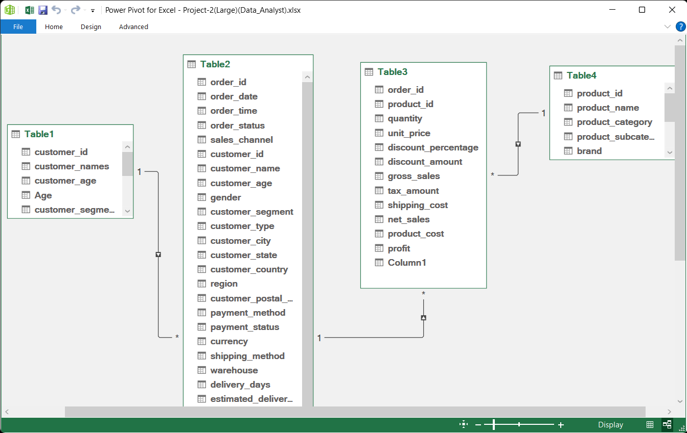
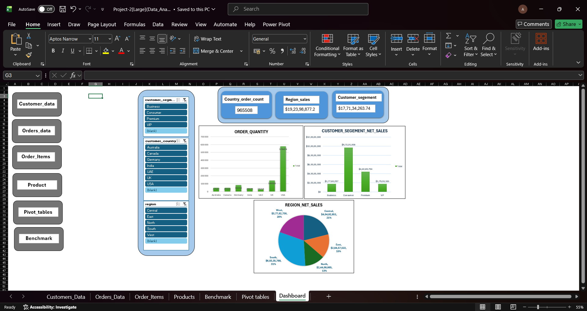

# E-Commerce Sales: Revenue Reconciliation, Data Modeling & Multi-Table Analysis

## 1. Project Overview

> **Dataset Size Notice:** Due to GitHub's 25 MB web upload limit on 150K+ multi-table transaction files, the complete, interactive workbook is hosted on Google Drive.

### 📥 Project Access
* **Full Interactive Workbook (.xlsx, ~100 MB):** [Click to Download via Google Drive](https://drive.google.com/uc?export=download&id=1MhA84TKiPsM6kHXba7nENGOXUynVFisc)
* **Visual Previews:** See the embedded dashboard and schema screenshots below.

---

* **Scope & Objective:** Sourced an enterprise e-commerce dataset containing 150,000+ transactions spanning 2021 through 2025 across four sheets. The primary objective was to audit, scrub, and structure the raw transactional data into a high-performance analytical model in Microsoft Excel to verify reporting integrity against a published revenue benchmark.
* **Core Technical Hurdles:** Diagnosed and resolved widespread formatting and structural issues: trimmed redundant whitespace (`TRIM`), converted numbers stored as text into true numeric data types, pasted values via Paste Special to remove formula dependencies, and used Go To Special (`Ctrl + G`) to isolate and handle blank cells. During relationship configuration in Power Pivot, resolved primary key duplication errors to enable active relationships. Diagnosed a multi-million-dollar calculation mismatch that initially inflated customer segment net sales to ~$192M, systematically cleansing customer entity records to reconcile the model down to the exact benchmark of **$177,134,263.74**.
* **Deliverables & Interface:** Engineered a normalized multi-table Data Model powering dynamic Pivot Tables, synced visual Pivot Charts, and real-time KPI scorecards. Built an executive dashboard with integrated global Slicers and centralized navigation buttons to provide a seamless, non-destructive user experience.

---

## 2. Data Architecture & Relational Schema

To avoid flat-file performance bottlenecks and volatile lookup formulas (`VLOOKUP`/`XLOOKUP`), the data was structured into a normalized snowflake-style schema inside Excel Power Pivot.

### Table Classifications
* **Dimension Tables (Lookup / Descriptive Attributes):**
  * `Customer_Data` — Master customer records (customer IDs, segments, countries).
  * `Products` — Product catalog master (product IDs, categories, product specifications).
* **Fact Tables (Transactional / Quantitative Metrics):**
  * `Order_Data` — Header-level transaction records (order IDs, customer links, order-level net sales).
  * `Order_Items` — Line-item transaction records (order-to-product mapping, item quantities, line profit).

### Primary & Foreign Key Mappings
* **`Customer_Data` $\leftrightarrow$ `Order_Data`**
  * **Key:** `customer_id`
  * **Cardinality:** One-to-Many ($1:\infty$)
  * **Role:** Enables customer demographic attributes to group and filter total order sales.
* **`Order_Data` $\leftrightarrow$ `Order_Items`**
  * **Key:** `order_id`
  * **Cardinality:** One-to-Many ($1:\infty$)
  * **Role:** Bridges overarching order header metadata down to specific itemized sales rows.
* **`Products` $\leftrightarrow$ `Order_Items`**
  * **Key:** `product_id`
  * **Cardinality:** One-to-Many ($1:\infty$)
  * **Role:** Allows product catalog categories to filter and group item-level profitability.
  * ### Relational Diagram View

---

## 3. Data Cleaning & Integrity Auditing

* **Data Normalization:** Cleaned raw text anomalies across 150K+ records using `TRIM`, explicit type casting, and range re-indexing.
* **Blank Cell Handling:** Used `Ctrl + G` (Go To Special $\rightarrow$ Blanks) to audit missing attributes in key columns, preventing broken relationship references.
* **Primary Key Enforcement:** Cleared duplicate values on master dimension tables (`customer_id` and `product_id`) without deleting transaction-level lines in `Order_Items`.
* **Revenue Reconciliation:** Eliminated cartesian join effects and granularity mismatches between header and line items, successfully verifying total net sales at **$177,134,263.74**.

---

## 4. Business Reporting, Key Findings & UX Design

### Business Intelligence Deliverables
1. **Customer Segment Performance:**
   * **Dimensions & Metrics:** Evaluated `customer_segment` against total `net_sales` ($177.1M verified).
   * **Key Finding:** The **Consumer** segment is the primary revenue driver, while the **Business (B2B)** segment contributed the least volume.
   * **Strategic Value:** Directs customer acquisition budgets toward high-return consumer campaigns while auditing B2B sales pipeline conversion.
2. **Regional Revenue Distribution:**
   * **Dimensions & Metrics:** Evaluated sales volume across geographic territories.
   * **Key Finding:** The **South** region generated outstanding sales volume, whereas the **North** region underperformed.
   * **Strategic Value:** Identifies geographic demand hubs to guide territory staffing and distribution focus.
3. **Country-Level Order Volume & Logistics Demand:**
   * **Dimensions & Metrics:** Evaluated order quantity aggregated by `customer_country`.
   * **Key Finding:** The **United States** drove the highest order volume, while markets like the **UAE** recorded minimal transaction counts.
   * **Strategic Value:** Guides freight contracts, warehouse inventory allocations, and international logistics investments.

### Dashboard UX & Interactive Features
* **Dynamic KPI Metric Cards:** Surfaces executive-level metrics at a glance: Customer Segment Net Sales, Regional Net Sales, and Total Order Quantity.
* **Synchronized Cross-Filtering:** Configured global Slicers wired to all three Pivot Tables via **Report Connections** for simultaneous, single-click updates across tables and charts.
* **Centralized Navigation Architecture:** Implemented sheet navigation buttons exclusively on the main dashboard menu, protecting high-volume data sheets from accidental layout corruption or broken Data Model links.
* **Executive Formatting:** Formatted all financial fields to clean US Dollar currency (`$`) with zero decimals.
* ### Executive Dashboard Interface

---

## 5. Tools & Technologies Used
* **Platform:** Microsoft Excel
* **Data Modeling:** Power Pivot, Relational Diagram View ($1:\infty$ Schemas)
* **Analysis & Visualization:** Pivot Tables, Pivot Charts, Global Slicers, Report Connections, KPI Cards
* **Data Cleansing:** `TRIM`, Type Conversions, Paste Special (Values), Go To Special (`Ctrl + G`)
